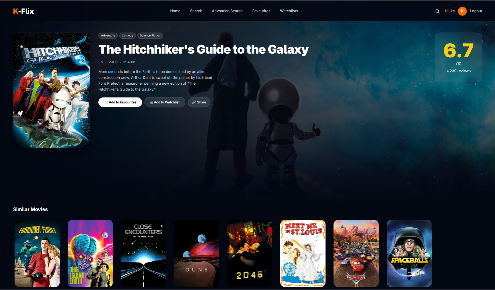
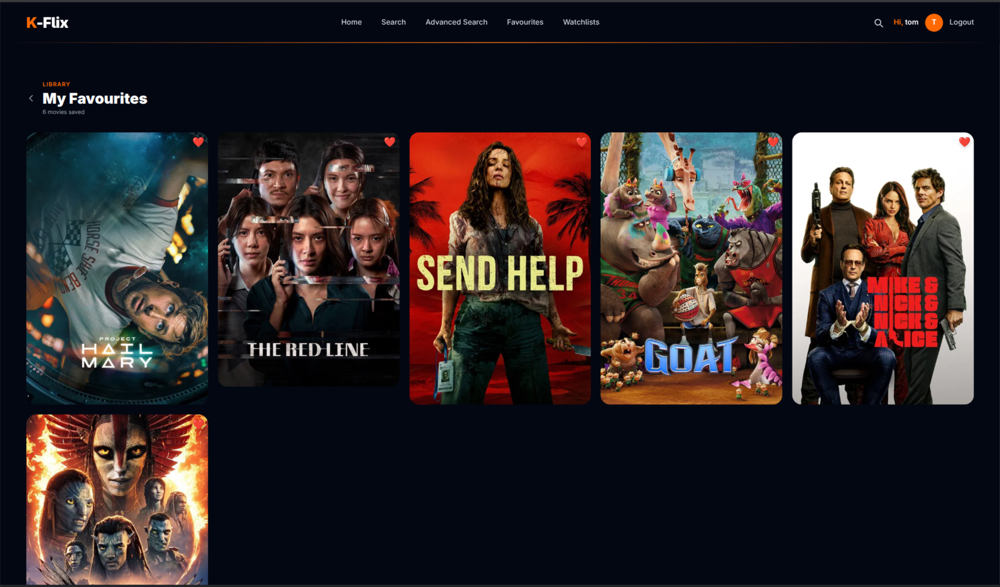
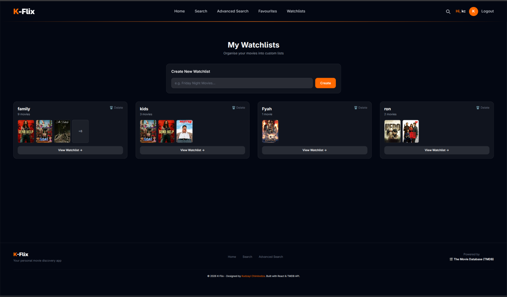
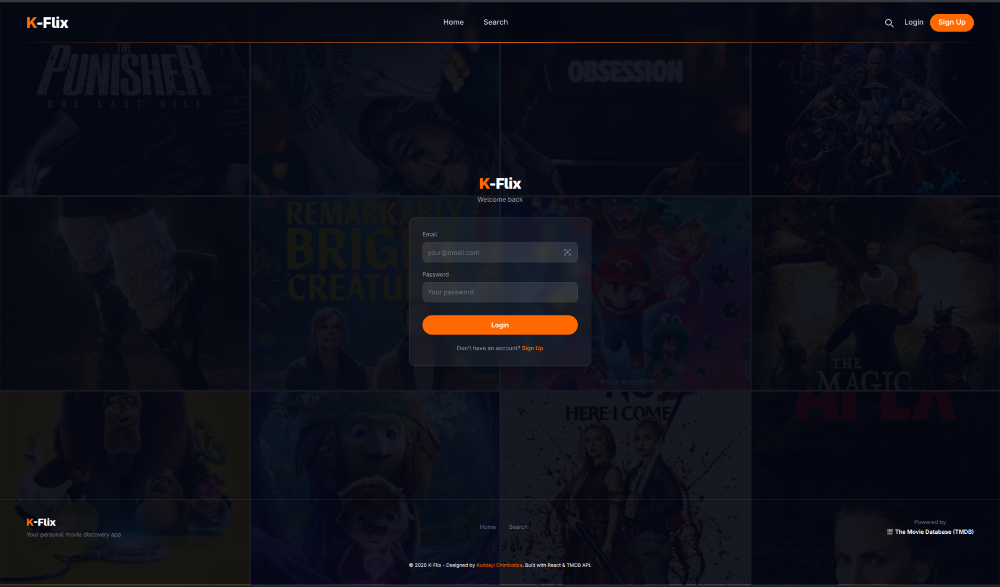

# K-Flix 🎬
A movie discovery and watchlist management app built with React 19 and Vite, powered by the TMDB API.

[](https://react.dev)
[](https://vitejs.dev)
[](https://tailwindcss.com)
[](https://github.com/kchimbodza/k-flix-react-app/actions)

---

## Features

- Browse trending movies updated daily from TMDB
- Search by keyword with advanced filters — genre, year, rating, language
- Full movie detail pages with overview, genres, and ratings
- User registration and login with protected routes
- Add movies to favourites and manage personal watchlists
- Share watchlists with other users
- Responsive design — mobile and desktop

---

## Architecture

<p align="center"></p>

- **Movie data** (trending, search, discover filters, details, similar, genres) comes straight from TMDB via `src/services/tmdb.js`.
- **User data** (accounts, favourites, watchlists) goes through `src/services/api.js` to `/api/`. In the deployed container, nginx forwards `/api/` to json-server on `localhost:3001`.
- **State** lives in two React contexts: `AuthContext` (logged-in user, kept in `localStorage`) and `FavouritesContext` (guest favourites in `localStorage`; a logged-in user's favourites are loaded from json-server).
- **Delivery:** this repo also contains the CI workflow, Dockerfile, Kubernetes manifests and Terraform used to run the app on AWS EKS. The full pipeline write-up is in [k-flix-devops-cicd-pipeline](https://github.com/kchimbodza/k-flix-devops-cicd-pipeline).

**Why this architecture**

| Choice | Why |
|---|---|
| Single-page app on Vite | Fast dev server and a static build that any web server (nginx) can host. |
| Context API instead of Redux | Only two pieces of shared state (user, favourites); contexts are enough. |
| JSON Server as the backend | A full REST API from one `db.json` file, with no backend code to write for a front-end project. |
| TMDB called from the browser | Movie data stays at the source; only user-specific data needs storing. |
| nginx proxy for `/api/` | The browser talks to one origin, and json-server runs beside nginx in the same pod. |

---

## Results

**Checks I re-ran locally** (13 Nov 2026, Node 26; same `src/` and lock file as the pipeline repo)

| Check | Result |
|---|---|
| `npm test` (Vitest) | 1 file, **3/3 tests pass** |
| `npm run lint` (ESLint) | 0 errors |
| `npm run build` (Vite) | builds, 330 kB JS (98 kB gzip), 36 kB CSS |

**CI history** (`gh run list -R kchimbodza/k-flix-react-app`, checked 13 Nov 2026): **10 runs, 7 passed, 3 failed.** All 3 failures were in the first hour of setting up the workflow; every run after that passed.

## What worked and what didn't

| | What | Detail |
|---|---|---|
| ✅ | Feature-complete app | Trending, search with filters, details, auth, favourites and shareable watchlists all work against TMDB and json-server (see screenshots). |
| ✅ | Same app deployed to Kubernetes | Fixed in commits: json-server moved behind an nginx `/api/` proxy, and its data moved to a writable `emptyDir` volume seeded from a ConfigMap. |
| ❌ fixed | CI set-up failures | Run 1 failed at the SonarCloud step (exit code 3). Runs 2 and 3 could not start: `aquasecurity/trivy-action@0.28.0` and `@0.36.0` do not exist; the tag needs a `v` (`v0.36.0`). |
| ⚠️ limit | Not real authentication | Passwords are stored in plain text in `db.json`, and login downloads the user list and compares in the browser. Fine for a demo, not for production. |
| ⚠️ limit | Small test suite | 3 smoke tests check that `App` renders, with every page mocked. |
| ⚠️ limit | Local `/api` needs a proxy | `api.js` now calls `/api`, but `vite.config.js` has no dev proxy. With `npm start`, `/api/users` returns the app's `index.html` (checked 13 Nov 2026), so login and watchlists only work behind nginx until a Vite proxy to `localhost:3001` is added. |
| ⚠️ limit | Data resets on pod restart | On Kubernetes, json-server writes to an `emptyDir` volume, so new users and watchlists are lost when the pod restarts. |

---

## Screenshots


*Hero banner with trending movies*


*Keyword search with genre, year, rating, and language filters*


*Full detail page with overview, genres, and ratings*


*Personal favourites list*


*Create and manage watchlists — shareable with other users*


*User login with protected route handling*

---

## Tech Stack

| Layer | Technology |
|---|---|
| Frontend | React 19, Vite, React Router v7 |
| Styling | Tailwind CSS v4 |
| State | Context API |
| Backend | JSON Server (local REST API) |
| Data | TMDB API |
| Testing | Vitest, Testing Library |
| Delivery | GitHub Actions, SonarCloud, Docker, Trivy, AWS ECR, ArgoCD, AWS EKS, Terraform |

---

## Getting Started

### Prerequisites

- Node.js 20+ (CI uses Node 20)
- npm
- Free [TMDB API key](https://www.themoviedb.org/settings/api)

### Installation

```bash
git clone https://github.com/kchimbodza/k-flix-react-app.git
cd k-flix-react-app
npm install
```

Create a `.env` file in the root:

```
VITE_TMDB_API_KEY=your_tmdb_api_key
VITE_TMDB_BASE_URL=https://api.themoviedb.org/3
VITE_TMDB_IMAGE_URL=https://image.tmdb.org/t/p/w500
```

### Run

```bash
# Terminal 1 — start JSON Server (local backend)
npm run server

# Terminal 2 — start the app
npm start

# Tests
npm test
```

Open [http://localhost:5173](http://localhost:5173)

---

## Notes

- JSON Server runs on port 3001 and must be started separately (see the `/api` proxy note above for local runs)
- Passwords are stored in plain text in `db.json` — this is a development demo, not production-ready auth

---

## License

MIT
